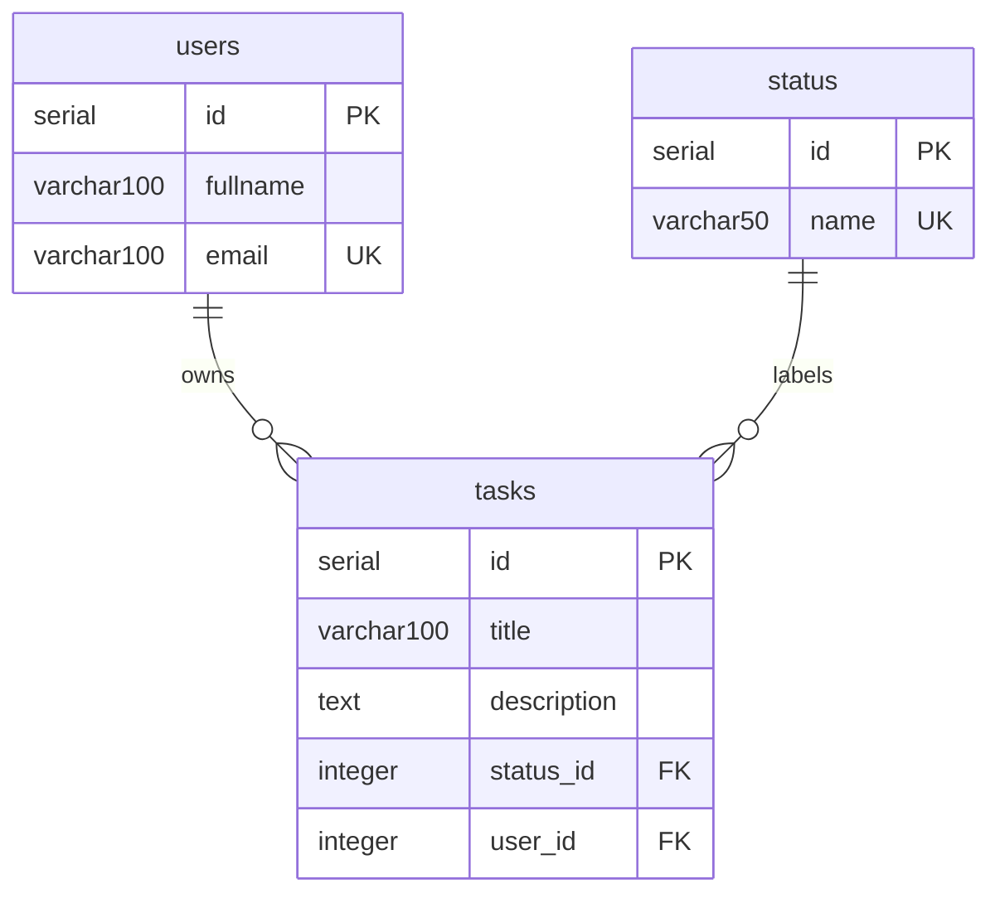

# PostgreSQL

[README](../README.md) · [Розробка](development.md) · [Експлуатація](operations.md) · [Верифікація](verification.md)

## Схема

`create_tables.py` створює таблиці без видалення наявних рядків. DDL виконується
в транзакції; з'єднання закривається після commit або rollback.
`CREATE TABLE IF NOT EXISTS` пропускає наявні таблиці: це не міграція й не перевірка
відповідності раніше створеної схеми.



Усі поля, крім `description`, обов'язкові. Видалення користувача каскадно видаляє
його завдання. Статуси: `new`, `in progress`, `completed`.

За замовчуванням застосунок підключається як `hw03_app`, володіє таблицями й послідовностями,
має `CONNECT` до своєї БД та `USAGE, CREATE` у `public`. Роль не має `SUPERUSER`,
`CREATEDB`, `CREATEROLE`, `REPLICATION` або `BYPASSRLS`.
Ініціалізація кластера явно використовує UTF-8 для українських даних.

## Наповнення

```bash
uv run --locked python create_tables.py
uv run --locked python seed.py
```

Один запуск додає 10 користувачів і 30 завдань. Статуси створюються ідемпотентно.
Останні два користувачі не мають завдань; дані містять усі статуси, різні поштові
домени, NULL і порожній опис. UUID у email дозволяє повторний запуск.
Faker генерує нові випадкові дані щоразу.

Повторний seed додає ще 10 користувачів і 30 завдань; це не скидання БД.
При помилці всередині seed уся транзакція відкочується.

## SQL-запити

`queries.sql` містить 14 пронумерованих запитів в одній транзакції.
Запити 3, 5, 7 і 9 змінюють дані; приклад використовує ID користувача 1
та завдань 1 і 2 після першого seed у новій БД. На раніше зміненій БД перевірте ці ID:
видалення рядків не скидає послідовності. Увесь файл завершується COMMIT.
Для гарантованих початкових даних і автоматичного прибирання використовуйте
`make demo`; результати описані в [практичних сценаріях](showcase.md).

| № | Операція |
| --- | --- |
| 1 | Завдання користувача за ID |
| 2 | Завдання зі статусом new через підзапит |
| 3 | Оновлення статусу завдання на in progress |
| 4 | Користувачі без завдань через NOT IN |
| 5 | Додавання завдання користувачу |
| 6 | Усі незавершені завдання |
| 7 | Видалення завдання |
| 8 | Пошук користувачів за email через LIKE |
| 9 | Оновлення імені користувача |
| 10 | Кількість завдань для кожного статусу, включно з нулем |
| 11 | Завдання користувачів певного поштового домену |
| 12 | Завдання без опису, зокрема NULL, порожній рядок або пробіли |
| 13 | Користувачі та їхні завдання in progress через INNER JOIN |
| 14 | Кількість завдань кожного користувача, включно з нулем |

Запуск через те саме перевірене підключення, без пароля в командному рядку:

```bash
uv run --locked python - <<'PYTHON'
from pathlib import Path
from conf.db import connect

with connect() as connection, connection.cursor() as cursor:
    cursor.execute(Path("queries.sql").read_text(), prepare=False)
    while True:
        print(cursor.fetchall() if cursor.description else cursor.statusmessage)
        if not cursor.nextset():
            break
PYTHON
```

`tests/integration/test_postgresql.py` перевіряє всі результати на фіксованому
наборі Alice/Bob/Carol. Наприклад, після змін запит 10 повертає кількості
`new=2`, `in progress=2`, `completed=0`, а запит 14 для ID 1, 2, 3 — 2, 2, 0 завдань.
